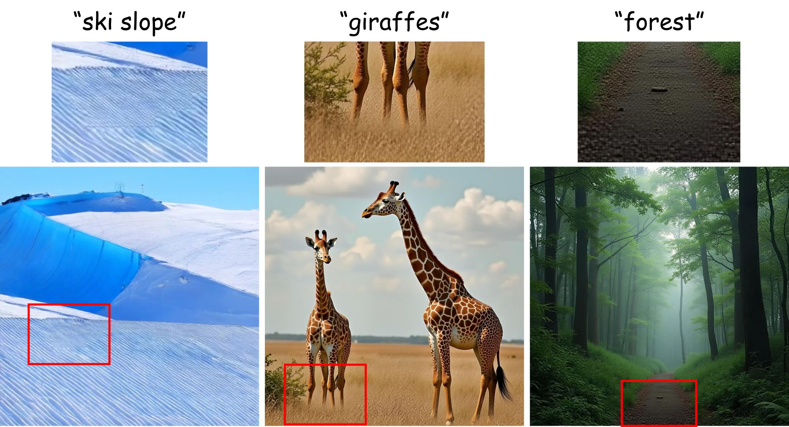

# Limitations and Future Work

## Limitations / Failure Cases
- Our method can still struggle on scenes with complex texture transitions between low-resolution and high-resolution regions. We have recently incorporated segmentation models to produce better saliency masks, which partially alleviate this issue, but there is still substantial room for improvement.

  

<em>Failure cases, with red boxes marking regions where complex LR-HR texture transitions still produce visible artifacts.</em>

## Future Work
- Our method achieves stable and efficient mixed-resolution generation with pretrained DiTs via a phase-alignment mechanism that restores a consistent native positional scale. A promising direction for future work is to move beyond inference-time correction by redesigning positional encodings and retraining DiTs accordingly, so that they can natively support mixed-resolution tokens in a more scale-invariant manner.
